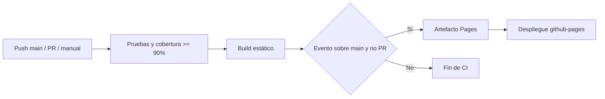

# Documentación del pipeline

Archivo: [ci-cd.yml](../.github/workflows/ci-cd.yml).

| Job | Dependencia | Responsabilidad |
| --- | --- | --- |
| `test` | Ninguna | Preparar Node 24 y ejecutar todas las pruebas con cobertura |
| `build` | `test` | Generar `dist/`; subir artefacto solo en main fuera de PR |
| `deploy` | `build` | Configurar y publicar Pages, exponer URL en environment |

No se ejecuta `npm install` porque el proyecto no tiene dependencias. Los scripts usan únicamente APIs nativas de Node.js. Por la misma razón, no se requiere lockfile ni caché npm.

`needs` impide continuar si falla la etapa anterior. Los PR no reciben permisos de publicación. El permiso global es `contents: read`; solo `deploy` obtiene `pages: write` e `id-token: write`. El entorno `github-pages` registra los despliegues y admite reglas de protección. La concurrencia de deploy evita publicaciones simultáneas sin cancelar una publicación activa.

## Pruebas y cobertura

- Unitarias: normalización, límites y entradas inválidas; cambio de estado sin mutación; borrado y resumen.
- Integración de UI: formulario → modelo → renderizado, error, alta, completar, reabrir y eliminar. Usa un adaptador DOM mínimo, no un navegador.
- Integración de build: genera un sitio en un directorio temporal y comprueba HTML y recursos relativos.
- Cobertura V8 con el runner de Node: mínimo global de 90 % para líneas, ramas y funciones de `src/**/*.js`. No incluye scripts ni pruebas; no significa cobertura de todo el repositorio.

Los resultados aparecen en el log de **Ejecutar pruebas y exigir cobertura del 90 por ciento**. El artefacto `github-pages` contiene el sitio publicable; la cobertura se muestra en consola, no como informe HTML.

Las versiones de acciones se fijan por versión mayor para esta práctica; para mayor control de cadena de suministro se pueden fijar por SHA verificado. Referencia: [GitHub Pages con workflows personalizados](https://docs.github.com/en/pages/getting-started-with-github-pages/using-custom-workflows-with-github-pages).
